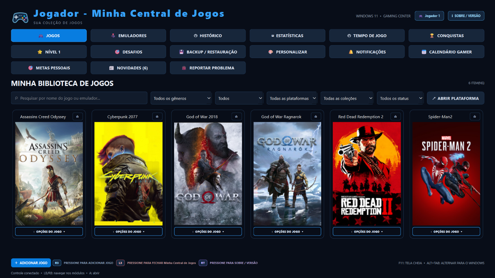
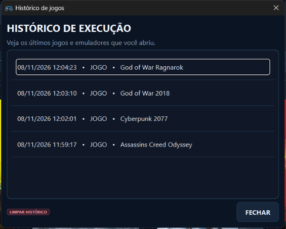
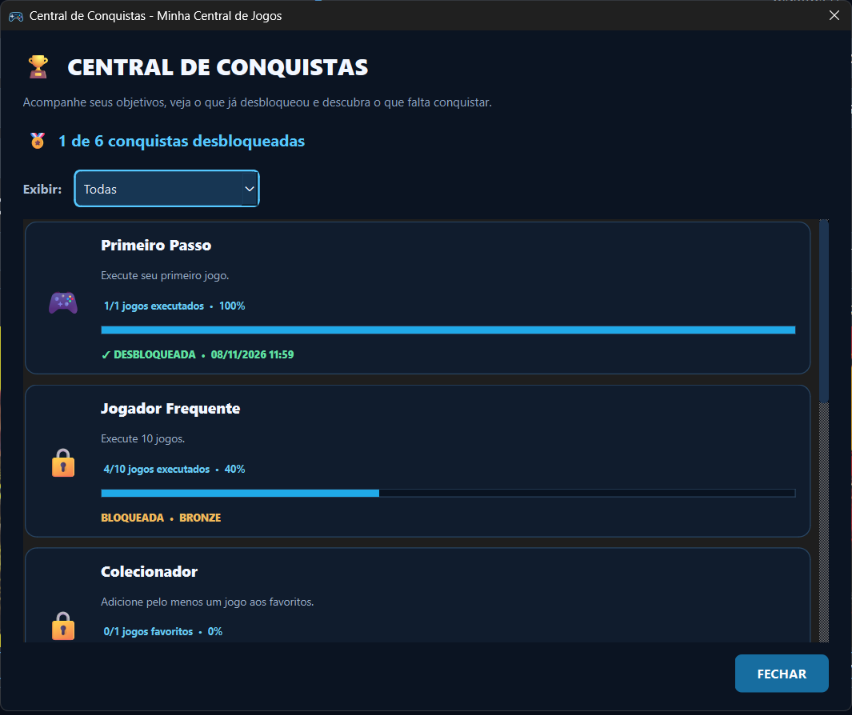
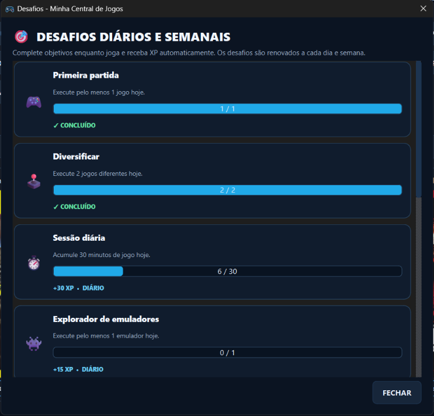
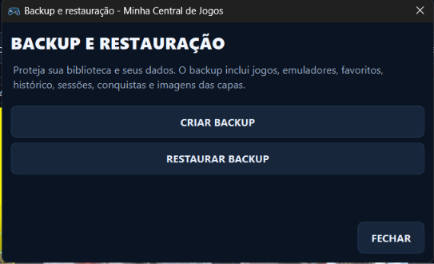
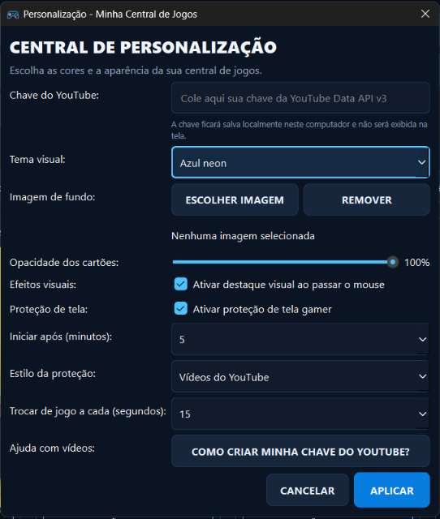

# 🎮 Minha Central de Jogos

### Sua coleção de jogos em um só lugar.

Organize sua biblioteca, acompanhe seu progresso e personalize sua experiência em uma central feita para jogadores.

---

## 🕹️ Conheça o aplicativo

A **Minha Central de Jogos** é um aplicativo para Windows desenvolvido para reunir ferramentas de organização e acompanhamento de uma biblioteca de jogos em uma única interface.

A tela principal apresenta os jogos em formato de cards, com capas, pesquisa e filtros. Os módulos adicionais ajudam a acompanhar o histórico, o tempo de jogo, as conquistas e os desafios.

*Biblioteca de jogos — tela principal da versão 1.0.0.*

## ✨ Funcionalidades

| Recurso | O que oferece |
|---|---|
| 🎮 Biblioteca de jogos | Visualização dos jogos em cards, pesquisa e filtros. |
| 🕹️ Emuladores | Área dedicada ao gerenciamento e acesso a emuladores. |
| ⭐ Favoritos | Marcação dos jogos preferidos. |
| 🕘 Histórico | Registro dos jogos e emuladores executados. |
| ⏱️ Tempo de jogo | Acompanhamento do tempo de utilização. |
| 🏆 Conquistas | Objetivos e progresso de conquistas. |
| 🎯 Desafios | Desafios diários e semanais com acompanhamento de progresso. |
| 📊 Estatísticas e nível | Recursos para acompanhar a evolução e a atividade. |
| 💾 Backup e restauração | Proteção e recuperação dos dados da biblioteca. |
| 🎨 Personalização | Opções de tema, imagem de fundo e efeitos visuais. |
| 🔔 Notificações e novidades | Área de avisos e novidades do aplicativo. |
| 📅 Calendário gamer e metas | Organização de metas e atividades relacionadas aos jogos. |

## 📸 Galeria de telas

### Histórico de jogos

Consulte os registros de execução dos jogos e emuladores.

### Conquistas

Acompanhe objetivos, progresso e conquistas desbloqueadas.

### Desafios diários e semanais

Visualize os desafios, acompanhe o progresso e veja as atividades concluídas.

### Backup e restauração

Crie cópias de segurança e restaure os dados da sua central.

### Personalização

Ajuste a aparência, escolha o tema visual e configure opções da experiência.

## ⬇️ Download e instalação

**Versão atual: 1.0.0**

1. Acesse a página de [Releases](https://github.com/Eilton-Costa/minha-central-de-jogos/releases/latest).
2. Baixe o arquivo `Instalador_Minha_Central_de_Jogos.exe`.
3. Execute o instalador e siga as instruções apresentadas.
4. Abra a Minha Central de Jogos pelo atalho criado na instalação.

> O instalador é distribuído pela página de Releases do GitHub. Consulte as informações da versão publicada antes de instalar.

## 🖥️ Informações do projeto

- **Aplicativo:** Minha Central de Jogos
- **Versão apresentada:** 1.0.0
- **Plataforma indicada na interface:** Windows 11
- **Tecnologias principais:** Python, PySide6 e pygame-ce
- **Código-fonte:** [GitHub](https://github.com/Eilton-Costa/minha-central-de-jogos)
- **Downloads:** [Releases](https://github.com/Eilton-Costa/minha-central-de-jogos/releases)

## 📜 Licença e distribuição

Este projeto utiliza a licença **PolyForm Noncommercial 1.0.0**.

O projeto pode ser utilizado, estudado, modificado e compartilhado de acordo com os termos da licença. O uso comercial não é permitido. Leia o arquivo [LICENSE](LICENSE) antes de utilizar ou redistribuir o projeto.

A proposta é disponibilizar a ferramenta gratuitamente para a comunidade, respeitando os termos da licença.

## 🤝 Contribuições

Sugestões, relatos de problemas e ideias para melhorias são bem-vindos. Utilize a área de [Issues](https://github.com/Eilton-Costa/minha-central-de-jogos/issues) do repositório para registrar sua contribuição.

---

**Minha Central de Jogos 1.0.0**

Feita para reunir sua coleção e acompanhar sua jornada gamer. 🎮

[Baixar agora](https://github.com/Eilton-Costa/minha-central-de-jogos/releases/latest) · [Ver código-fonte](https://github.com/Eilton-Costa/minha-central-de-jogos)

